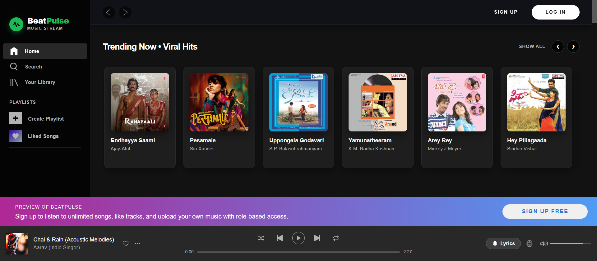
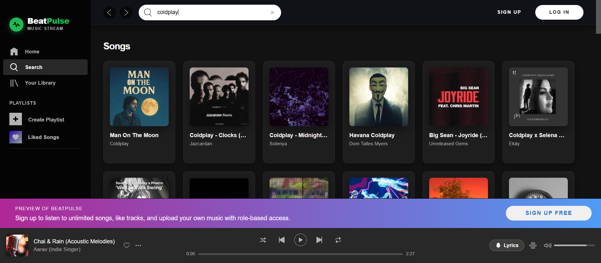
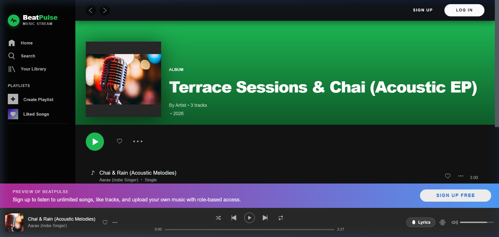
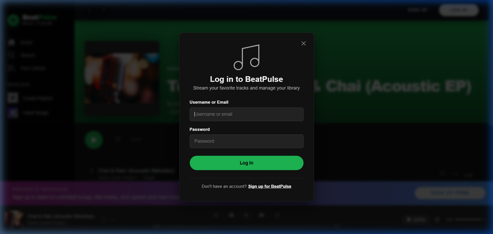

# 🎵 BeatPulse — Spotify-Inspired React Client

A modern front-end single page application (SPA) inspired by the official [Spotify Web Player](https://open.spotify.com/). Built from scratch using React to replicate the interface, fluid playback dynamics, and deep state-management architecture of Spotify — enhanced with custom multi-tier Role-Based Access Control (RBAC) and synchronized lyrics.

Works in conjunction with the [BeatPulse Express Backend](../complete-backend/).

---

## 📑 Table of Contents
- [Description](#description)
- [Visual Demonstrations](#visual-demonstrations)
- [Motivation](#motivation)
- [Tech Stack](#tech-stack)
- [Installation & Setup](#installation--setup)
- [Core Architecture & Deep-Dive](#core-architecture--deep-dive)
  - [Authentication & Token Handling](#authentication--token-handling)
  - [Custom Hooks (`useInfiScroll` & `useTokenScroll`)](#custom-hooks-useinfiscroll--usetokenscroll)
  - [Live Search with Request Cancellation](#live-search-with-request-cancellation)
  - [Continuous Audio Playback Engine](#continuous-audio-playback-engine)

---

## 🎧 Description

BeatPulse consumes streaming data and replicates the real-world front-end behaviors of Spotify:
- **Unauthenticated Mode**: Guests can freely explore the catalog, search across Indian and international artists, discover trending playlists, and preview albums. Protected actions (e.g., creating playlists, liking songs, uploading music) prompt an authentication modal.
- **Authenticated Mode**: Logged-in listeners can manage their personal library, build custom playlists, favorite tracks, and enjoy synchronized timestamped lyrics.
- **Artist Studio (RBAC)**: Verified creators gain access to an integrated Artist Studio to upload new music tracks and album artwork directly to the platform.

---

## 📸 Visual Demonstrations

### 1. Main Home Screen
The iconic dark-mode interface featuring curated rows, artist playlists, and a persistent bottom playback bar:


### 2. Live Instant Search & Genre Discovery
Real-time filtering as you type with debounced queries and automatic request cancellation:


### 3. Album & Playlist Detail Experience
High-resolution cover art banner with ambient gradients and interactive tracklist:


### 4. Authentication & RBAC Modal
Modal authentication with in-memory token state and session recovery:


---

## 💡 Motivation

This project was built to master advanced React development and complex front-end state architecture:
- **No Third-Party UI Libraries**: The majority of the React components, sliders, modals, and navigation systems were designed and written from scratch in Vanilla CSS and React. This hands-on approach builds a fundamental understanding of DOM event handling, layout geometry, and render cycles.
- **Real-World Complex State**: A music streaming client is one of the most challenging SPAs to architect because the audio playback state must persist seamlessly while the user navigates across dozens of nested routes.

---

## 🛠️ Tech Stack

- **Framework**: React 16.13 (Create React App)
- **Routing**: `react-router-dom` v5
- **HTTP Client**: `axios` (with CancelToken and interceptors)
- **State Architecture**: React Context API + Custom Hooks
- **Styling**: Vanilla CSS3 (Glassmorphism, CSS Grid, Flexbox, Keyframe Animations)

---

## 🚀 Installation & Setup

### Prerequisites
- [Node.js](https://nodejs.org/) (v18 or v20 recommended)
- [npm](https://npmjs.com/)

### 1. Clone the Repository
```bash
git clone https://github.com/PadmavathiPachitala/Beatpulse.git
cd Beatpulse/frontend
```

### 2. Install Dependencies
```bash
npm install
```

### 3. Configure API Endpoint
Create a `.env` file in the `frontend/` directory (or use `.env.example`):
```env
REACT_APP_API_URL=http://localhost:4000/api
```

### 4. Start the Application
```bash
npm start
```
The app will open automatically at [http://localhost:3000](http://localhost:3000).

---

## 🏛️ Core Architecture & Deep-Dive

### 1. Authentication & Token Handling
To keep credentials secure against XSS and XSRF attacks, BeatPulse implements a dual-token strategy:
- The **Refresh Token** is stored in an `HttpOnly`, `SameSite` secure cookie, ensuring JavaScript cannot access it directly.
- The **Access Token** is stored strictly **in-memory** within the React state context.
- When the user refreshes the page, an silent refresh handshake is performed with the backend to restore user identity without exposing credentials.

### 2. Custom Hooks (`useInfiScroll` & `useTokenScroll`)
Infinite scrolling for playlists and browse feeds is powered by two custom hooks:
- Both hooks leverage `useState`, `useRef`, `useCallback`, and the browser's native **`IntersectionObserver` API**.
- The hook returns a `useCallback` ref assigned to the last item in the list. As the user scrolls and the sentinel element intersects the viewport, the observer triggers the pagination callback to fetch the next batch.
- Child components use `React.forwardRef` to pass the DOM reference cleanly without breaking component encapsulation.

### 3. Live Search with Request Cancellation
As the user types into the search box, the client fires search queries. However, fast typing can trigger multiple concurrent network requests, leading to potential race conditions where an older request finishes *after* a newer one.
- To solve this, BeatPulse utilizes **Axios `CancelToken`** (and `AbortController`): whenever a new keystroke occurs, any pending in-flight request is cancelled on the fly.
- A 300ms debounce ensures optimal network efficiency.

### 4. Continuous Audio Playback Engine
The audio player lives outside the main route view inside a persistent global footer shell. The global player state (`isPlaying`, `currentTrack`, `currentTime`, `volume`, `shuffle`, `repeat`) is governed via React Context, ensuring playback continues uninterrupted when browsing albums, artists, or search results.
